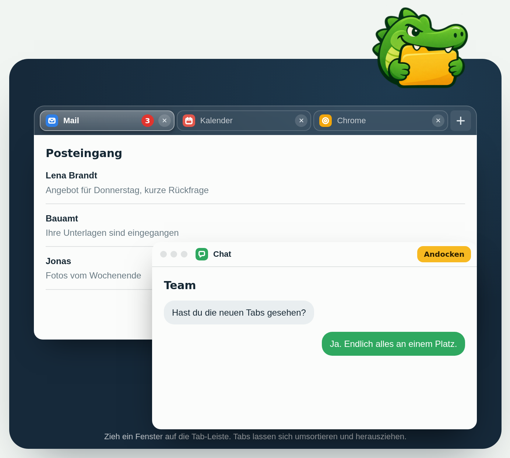

<div align="center">


# Dockodile

**Tabs für Programme auf Mac und Windows.**

Dockodile heftet Fenster verschiedener Programme zusammen.<br>
Mail, Kalender und Chat teilen sich dann eine Tab-Leiste, so wie Tabs im Browser.

*Dockodile groups windows of different apps behind one shared tab bar, like browser tabs for your whole desktop.*

**[Website](https://dockodile.de)** · **[Beta-Zugang anfragen](https://dockodile.de/#preis)** · **[Selbst bauen](#kostenlos-selbst-bauen)** · **[☕ Kaffee spendieren](https://buymeacoffee.com/riccardolakecode)**

<br>

<a href="https://dockodile.de"></a>

<sub>Darstellung aus der Live-Demo auf <a href="https://dockodile.de">dockodile.de</a>. Dort kannst du es ausprobieren und das Video ansehen.</sub>

</div>

## In drei Schritten zur eigenen Tab-Gruppe

| 1. Zusammenziehen | 2. Wechseln | 3. Als Paket sichern |
|---|---|---|
| Zieh ein Fenster auf den oberen Rand eines anderen. Beim Loslassen werden beide zu Tabs einer Gruppe. | Ein Klick auf den Tab zeigt das Programm. Die Gruppe verschiebst und skalierst du wie ein einzelnes Fenster. | Speichere die Gruppe und gib ihr ein Kürzel. <kbd>⌃</kbd> <kbd>⌥</kbd> <kbd>1</kbd> startet alle Programme und baut die Tabs wieder auf. |

## Was Dockodile kann

- **Fenster zusammenziehen.** Ein Fenster an seiner Titelleiste auf den oberen Rand eines anderen ziehen und loslassen. Fertig ist die Gruppe.
- **Tabs wie im Browser.** Klick wechselt das Programm, seitliches Ziehen sortiert um, ein Tab lässt sich nach unten herausziehen und hängt dann an der Maus.
- **Ungelesen-Zähler.** Zeigt ein Programm eine Zahl an seinem Dock-Symbol, etwa neue Nachrichten, steht dieselbe Zahl rot am Tab.
- **Plus-Menü.** Das Plus neben den Tabs listet alle offenen Fenster, die noch in keiner Gruppe sind.
- **Gruppe schließen.** Das X ganz rechts in der Tab-Leiste fragt nach: nur die Gruppe auflösen oder die Programme beenden.
- **Programme suchen.** Das Plus öffnet eine Liste mit Suchfeld. Ab zwei Buchstaben erscheinen alle installierten Programme, die Auswahl startet das Programm und hängt es als Tab an.
- **Startende Apps.** Fehlt beim Öffnen eines Pakets noch eine App, zeigt die Leiste sie schon als pulsierenden Tab an ihrem gespeicherten Platz. Die Tabs stehen in der gespeicherten Reihenfolge.
- **Gruppe bewegen und skalieren.** Am freien Teil der Tab-Leiste ziehen oder am Fenster selbst. Die beiden oberen Ecken der Tab-Leiste ändern die Größe der Gruppe. Ein Doppelklick auf die Leiste füllt den Bildschirm, ein zweiter stellt die alte Größe wieder her.
- **Pakete.** Eine Gruppe lässt sich unter einem Namen sichern. Ein Klick oder ein Tastenkürzel startet die Programme und setzt sie wieder zusammen, am gemerkten Platz.
- **Frei wählbare Kürzel.** Jedes Paket bekommt ein eigenes, systemweites Kürzel. Dockodile lehnt Kombinationen ab, die schon vergeben sind.
- **Sicher bei wechselnden Bildschirmen.** Ist der Monitor von damals nicht mehr angeschlossen, öffnet sich ein Paket sichtbar auf dem Hauptbildschirm.
- **Autostart.** Ein Schalter im Menü startet Dockodile beim Anmelden.

Auf dem Mac läuft Dockodile als Symbol in der Menüleiste und hat kein Dock-Symbol. Die Windows-Ausgabe läuft im Infobereich der Taskleiste. Ihre Bedienung und Grenzen stehen in [windows/ANLEITUNG.md](windows/ANLEITUNG.md). Die Oberfläche gibt es auf Deutsch und Englisch. Die Sprache wählst du beim ersten Start oder später im Menü unter „Sprache“.

## Fertig laden oder selbst bauen

| | Fertige App | Selbst bauen |
|---|---|---|
| Zugang | öffentlicher Verkauf derzeit pausiert, Beta-Zugang auf Anfrage | kostenlos |
| Was du bekommst | notarisierten Mac-Download oder Windows-Ausgabe | Quelltext aus diesem Repository |
| Updates | Website-Ausgabe nach einmaliger Freischaltung in der App; Store-Ausgabe über Microsoft | selbst neu bauen |
| Systeme | macOS 14 oder neuer; Windows 11 (64 Bit) | Mac-Quelltext in `src/`, Windows-Quelltext in `windows/` |

Der bisherige Preis von 7 € unterstützt den Apple-Developer-Account sowie laufende Kosten für Server, Wartung und Support. Der öffentliche Verkauf bleibt während der Beta pausiert. Bestehende Käufe behalten ihren Update-Zugang.

**[Beta-Zugang auf dockodile.de anfragen](https://dockodile.de/#preis)**

Aktueller Quellstand: **Mac 0.3.1 (Build 4)** und **Windows 0.4.1**. Die Versionsnummern werden für beide Systeme getrennt geführt. Der neue Windows-Store-Build ist zur Zertifizierung eingereicht.

### Mac kostenlos selbst bauen

Der Quelltext ist frei. Wer will, baut Dockodile selbst, das kostet nichts und kann alles, was die gekaufte Version kann.

Voraussetzungen:

- macOS 14 oder neuer
- Xcode oder die Xcode Command Line Tools (`xcode-select --install`)

```sh
git clone https://github.com/value1338/dockodile.git
cd dockodile
./bauen.command
```

`bauen.command` baut `Dockodile.app`, schreibt `build.log` und startet die App. Ein Doppelklick im Finder tut dasselbe.

Beim ersten Lauf bietet das Skript an, ein eigenes Signaturzertifikat „Dockodile Lokal“ in deinem Anmelde-Schlüsselbund anzulegen. Sag ja, wenn du Dockodile öfter neu baust: macOS merkt sich den Bedienungshilfen-Zugriff anhand der Signatur, und ohne festes Zertifikat musst du ihn nach jedem Build neu erteilen. Das Zertifikat ist selbst signiert, gilt nur auf deinem Mac und wird nirgends hochgeladen. macOS fragt dafür einmal nach deinem Passwort. Sagst du nein, baut das Skript mit einer Wegwerf-Signatur und fragt nicht wieder.

Beim ersten Start fragt Dockodile nach dem Zugriff **Bedienungshilfen**. Den vergibst du unter Systemeinstellungen, Datenschutz & Sicherheit, Bedienungshilfen. Dockodile merkt selbst, sobald er da ist.

### Windows selbst bauen

Im Verzeichnis `windows` mit installiertem Rust und den Windows-Buildwerkzeugen:

```sh
cargo build --release
```

Die Anleitung mit Funktionen, Systemgrenzen und Prüfschritten steht in [windows/ANLEITUNG.md](windows/ANLEITUNG.md). Für ein Store-Paket gibt es [windows/MSIX.md](windows/MSIX.md).

### Mac-Updates

Für Updates direkt in der App einmal den persönlichen Update-Link öffnen und **„In Dockodile freischalten“** wählen. Die App muss signiert sein und sich am Installationsort ersetzen lassen. Fehlt eine Voraussetzung, öffnet sie die Update-Seite.

Beim manuellen Update die App beenden und die vorhandene `Dockodile.app` in Programme im Finder **ersetzen**. Nicht „Beide behalten“ wählen. Version 0.3.1 prüft vor dem automatischen Austausch Bundle-ID, Entwicklersignatur und Versionsnummer und ersetzt die bestehende Installation am selben Pfad.

## Bedienung

| Aktion | So geht es |
|---|---|
| Fenster zu Tabs machen | Fenster an der Titelleiste auf den oberen Rand eines anderen ziehen, bei „Loslassen zum Tabben“ loslassen |
| Fenster zu einer Gruppe hinzufügen | Auf die Tab-Leiste ziehen oder über das Plus auswählen |
| Tab wechseln | Tab anklicken, oder per Cmd-Tab zum Programm wechseln |
| Tabs umsortieren | Tab seitlich ziehen |
| Tab lösen | Tab nach unten herausziehen, auf das Kreuz klicken oder Rechtsklick, „Tab aus der Gruppe lösen“ |
| Gruppe verschieben | Freien Teil der Tab-Leiste ziehen oder das Fenster an seiner Titelleiste |
| Bildschirm füllen | Doppelklick auf den freien Teil der Tab-Leiste |
| Gruppe als Paket sichern | Plus oder Rechtsklick auf einen Tab, „Diese Gruppe als Paket sichern …“ |
| Paket öffnen | Dockodile-Menü in der Menüleiste oder das Kürzel des Pakets |
| Kürzel ändern, Paket löschen | Dockodile-Menü in der Menüleiste |
| Alle Gruppen auflösen | Dockodile-Menü in der Menüleiste |

## Mehr im Detail

<details>
<summary><b>Pakete und Kürzel</b></summary>
<br>

Ein Paket merkt sich die Programme einer Gruppe, ihre Reihenfolge sowie Platz und Größe. Der Inhalt der Fenster wird nicht gespeichert.

Sicherst du eine Gruppe, während es schon Pakete gibt, fragt Dockodile, ob ein neues Paket entstehen oder ein vorhandenes aktualisiert werden soll. Vorgeschlagen wird das Paket, aus dem die Gruppe stammt. Beim Aktualisieren bleiben Name und Kürzel erhalten.

Neue Pakete bekommen das erste freie Kürzel aus Control-Option-1 bis 9. Unter „Kürzel ändern“ vergibst du ein eigenes. Dockodile lehnt ein Kürzel ab, wenn

- es schon zu einem anderen Paket gehört,
- macOS es selbst nutzt, etwa für Spotlight oder Mission Control,
- macOS die Anmeldung verweigert,
- weder Control noch Option enthalten ist.

macOS zeigt einer App keine vollständige Liste der Kürzel anderer Programme. Überschneidungen mit fremden Werkzeugen lassen sich deshalb nicht in jedem Fall erkennen.

</details>

<details>
<summary><b>Für KI-Agenten, Raycast und Kurzbefehle</b></summary>
<br>

Dockodile lässt sich ohne Maus steuern:

```
open "dockodile://open?paket=Büro"
open "dockodile://tab?app=Mail"
```

`open` öffnet ein gesichertes Paket oder holt seine Gruppe nach vorn. `tab` zeigt den Tab, dessen Programm oder Titel den Namen enthält. Findet Dockodile nichts, ertönt der Warnton.

Die Tab-Leiste ist für Bedienungshilfen ausgezeichnet. Jeder Tab ist ein benannter Knopf ("Mail, Tab 2 von 3") mit dem Zustand "ausgewählt", das Fenster der Leiste heißt "Dockodile: Mail, Kalender". VoiceOver und Agenten, die die Bedienungshilfen-Struktur lesen, können die Gruppe so erkennen und bedienen.

</details>

<details>
<summary><b>Berechtigungen und Daten</b></summary>
<br>

- **Bedienungshilfen.** Ohne diesen Zugriff darf keine App fremde Fenster bewegen. Dockodile nutzt ihn ausschließlich dafür: Fenster finden, verschieben, in der Größe ändern, nach vorn holen.
- **Netzwerk nur für Updates.** Dockodile fragt beim Start und einmal am Tag bei dockodile.de nach der neuesten Versionsnummer, ohne Kennung. „Automatisch aktualisieren“ im Menü schaltet das ab. Wer gekauft hat, schaltet mit dem Link von [dockodile.de/update.html](https://dockodile.de/update.html) die Installation direkt in der App frei; dann sendet die App beim Laden einer neuen Version den Schlüssel des Kaufs. Fenster, Programme und Pakete verlassen den Mac nicht.
- **Gespeichert wird lokal.** Pakete liegen in den Einstellungen der App auf deinem Mac: Programmkennung, Programmpfad, Fenstertitel zum Wiedererkennen und der Rahmen der Gruppe.

</details>

<details>
<summary><b>Wie es funktioniert und wo die Grenzen liegen</b></summary>
<br>

macOS erlaubt es nicht, ein fremdes Fenster in ein anderes einzubetten. Dockodile zeigt deshalb immer nur das Fenster des aktiven Tabs und legt eine eigene, rahmenlose Leiste darüber. Die Fenster der übrigen Tabs warten am rechten unteren Bildschirmrand außerhalb des sichtbaren Bereichs. Ein Punkt davon bleibt sichtbar, weil macOS kein Fenster ganz aus dem Bild lässt.

Daraus folgt:

- In Mission Control und im Fenster-Menü bleiben es einzelne Fenster. Die Tab-Leiste taucht dort nicht auf.
- Vollbild-Fenster und Fenster mit fester Größe lassen sich nicht sauber gruppieren.
- Dockodile bewegt ein fremdes Fenster, indem es das Programm darum bittet. Beim Ziehen an der Tab-Leiste läuft die Gruppe so flüssig, wie das Programm antwortet. Am flüssigsten ist das Ziehen an der Titelleiste des Fensters selbst.
- Stürzt Dockodile ab, liegen die wartenden Fenster noch am Bildschirmrand. Beim nächsten Start holt Dockodile sie zurück. Beim normalen Beenden gibt Dockodile alle Fenster vorher frei.
- Einzelne Tabs innerhalb eines Browserfensters kann Dockodile nicht trennen. Gruppiert werden ganze Fenster.
- Offene Gruppen überleben keinen Neustart von Dockodile. Dafür gibt es die Pakete.

</details>

<details>
<summary><b>Warum nicht im Mac App Store</b></summary>
<br>

Der Mac App Store verlangt die App Sandbox, und eine App in der Sandbox darf fremde Fenster nicht steuern. Apples Entwickler-Support empfiehlt für solche Werkzeuge die direkte Verteilung. Um Fenster eindeutig zu erkennen, nutzt Dockodile außerdem eine macOS-Funktion, die Apple nicht offiziell für Entwickler freigegeben hat (`_AXUIElementGetWindow`). Sie ist seit vielen macOS-Versionen unverändert und in Fenster-Werkzeugen üblich. Sollte Apple sie ändern, braucht Dockodile ein Update.

</details>

<details>
<summary><b>Entwicklung</b></summary>
<br>

Dockodile ist in Swift geschrieben, mit AppKit, SwiftUI und der Accessibility-API. Es gibt kein Xcode-Projekt, `bauen.command` ruft `swiftc` direkt auf.

| Pfad | Inhalt |
|---|---|
| `src/Windows.swift` | Helfer rund um Accessibility-Fenster und Koordinaten |
| `src/Hub.swift` | Gruppen, Zielerkennung beim Ziehen, Parken, Pakete |
| `src/Views.swift` | Tab-Leiste, Plus-Menü, Hinweis beim Ziehen, Fenster für Anleitung und Kürzel |
| `src/App.swift` | Einstieg, Menüleiste, Autostart, Tastenkürzel |
| `Icon/` | App-Symbol, Logo für das Willkommensfenster und das Symbol für die Menüleiste |

Die Signatur wählt `bauen.command` in dieser Reihenfolge: die Umgebungsvariable `DOCKODILE_SIGN`, sonst das lokale Zertifikat „Dockodile Lokal“, sonst eine Wegwerf-Signatur. Welche es wurde, steht als Zeile „signiert mit“ in `build.log`.

```sh
DOCKODILE_SIGN="Name deines Zertifikats" ./bauen.command
```

Hast du das Angebot für das lokale Zertifikat abgelehnt und willst es doch, lösche die Datei `.build/ohne-signatur` und starte das Skript noch einmal. Das Zertifikat entfernst du in der Schlüsselbundverwaltung unter „Dockodile Lokal“.

Eine so gebaute App läuft nur auf dem Mac, auf dem sie gebaut wurde. Zum Weitergeben an andere braucht es eine Developer ID von Apple und eine Notarisierung.

Automatische Tests gibt es nicht. Das Verhalten hängt an fremden Programmen und wird von Hand am Mac geprüft.

</details>

## Status

Frühe Version 0.2. Dockodile ist bisher auf einem einzigen Mac im Alltag erprobt. Programme verhalten sich beim Bewegen ihrer Fenster unterschiedlich, es wird Ecken geben, die noch haken. Fehlerberichte mit Programmname und macOS-Version helfen am meisten.

## Unterstützen

Dockodile gefällt dir? Dann spendier mir gern einen Kaffee: **[Buy Me a Coffee](https://buymeacoffee.com/riccardolakecode)** oder **[PayPal](https://paypal.me/riccardorei)**.

## Lizenz

Der Quelltext steht unter der [GNU General Public License 3.0](LICENSE). Du darfst ihn nutzen, verändern und weitergeben, auch verkaufen. Wer eine veränderte Fassung weitergibt, muss deren Quelltext ebenfalls unter der GPL-3.0 offenlegen.

Der Name „Dockodile“ und das Krokodil-Logo gehören nicht zur Lizenz. Veränderte Fassungen brauchen einen eigenen Namen und ein eigenes Icon.
